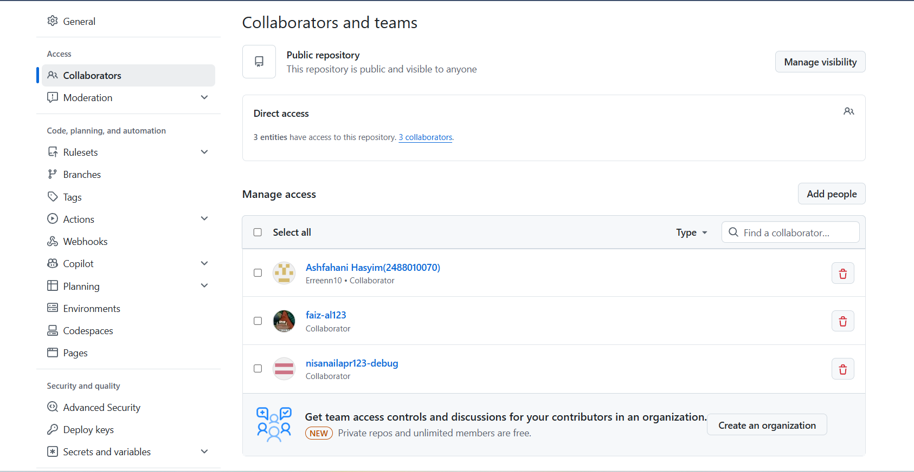
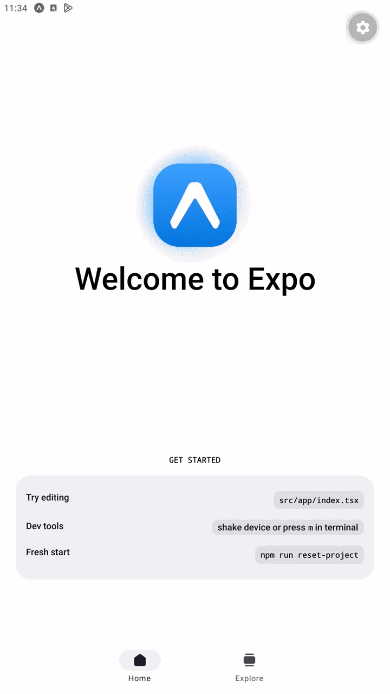
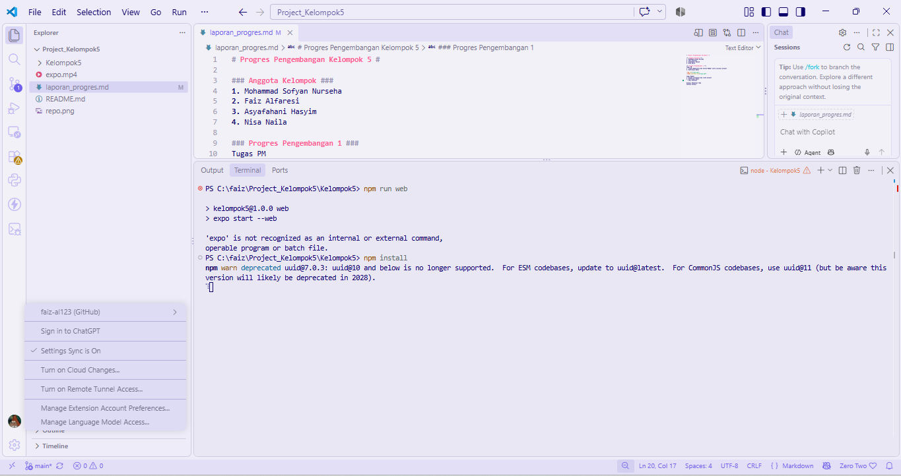

# Progres Pengembangan Kelompok 5 #

### Anggota Kelompok ###
1. Mohammad Sofyan Nurseha 
2. Faiz Alfaresi 
3. Ashfahani Hasyim
4. Nisa Naila

### Progres Pengembangan 1 ###
Tugas PM
1. Create Repository dan Invite Member serta inisiasi project
2. Konfirmasi Bukti

Tugas Member
1. Accept invitation dan clone project
2. Konfirmasi Bukti
 - Faiz Alfaresi
 

Progres Pengembangan 1 Tugas Member

Nama: Ashfahani Hasyim
GitHub Username: Erreenn10
Email: ashfahani77@gmail.com

Tugas: Accept Invitation, Clone Project, Setup & Run Project

Konfirmasi Bukti:

No	Bukti	Keterangan
1	[
]	Berhasil accept invitation dari PM
2	[
]	Project berhasil di-clone ke C:\laragon\www\Project_Baru
3	[
]	Dependencies berhasil di-install
4	[
]	Project berhasil dijalankan di localhost:8081

Diskusi Penentuan Tema
Catatan Diskusi
Ada beberapa tema yang ingin kami jadikan sebagai project UTS dan UAS
- Rental PS
- Sistem Mahad
- Sistem Parkir