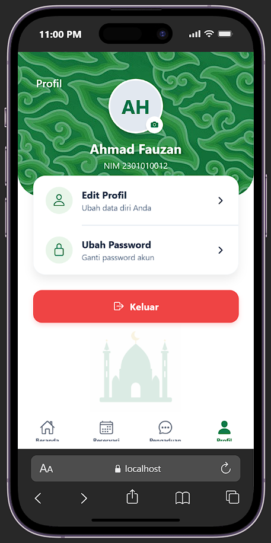

# Laporan Project Kelompok 5 #

### Anggota Kelompok ###
1. Mohammad Sofyan Nurseha 
2. Faiz Alfaresi 
3. Ashfahani Hasyim
4. Nisa Naila

### Tema Yang Diambil ###
- My Mahad (Layanan Asrama & Reservasi Kamar Mahasiswa)
- Fitur Utama:
1. Reservasi Kamar
2. Pengaduan Fasilitas
3. Absensi Kegiatan

### Hasil Wawancara ###
- Dokumentasi

 

- Notulensi:
1. Sudah ada Apk sahaja (tapi bukan reservasi kamar hanya pembayaran, remedial, evaluasi tutor)
2. Laundry sudah ada sistem tersendiri
3. Total kamar di gedung jadid 25 per lantai dan di gedung qodim 25 perlantai 
4. Totalnya 200 kamar 
5. Isi fasilitas sudah tersedia semua (Kasur, meja belajar, lemari)
6. Kapasitas per kamar 4-6 orang 
7. Pengaduan fasilitas masih melalui wali kamarnya
8. Absensi kegiatan Ma'had masih semi aplikasi 

### Pembagian Tugas ###

1. Mohammad Sofyan Nurseha (Halaman Beranda)
2. Faiz Alfaresi (Halaman Register)
3. Ashfahani Hasyim (Halaman Profil)
4. Nisa Naila (Halaman Login)

### Hasil Halaman ###

1. Mohammad Sofyan Nurseha (Halaman Beranda)

2. Ashfahani Hasyim (Penambahan halaman profil dan memperbaiki navigasi tab)

3. Nisa Naila (Membuat tampilan Login)

4. Faiz Alfaresi (Membuat register page)

## Laporan Halaman untuk UTS ##

### Demo Tiap Halaman ###
1. Ashfahani Hasyim ( Menampilkan halaman profil sesuai desain)

<video controls src="dokumentasi\profil.mp4" width="50%" title="Title"></video>

2. Mohammad Sofyan Nurseha 
- (Halaman Beranda dan Reservasi)

- (Halaman Login)

3. Nisa Naila (Halaman Pengaduan)

4. Faiz Alfaresi (Halaman Registrasi)

## Laporan Revisian Fitus di UTS ##
1. Ashfahani Hasyim => melakukan perbaikan di halaman edit profil, bagian NIM menjadi primary key

